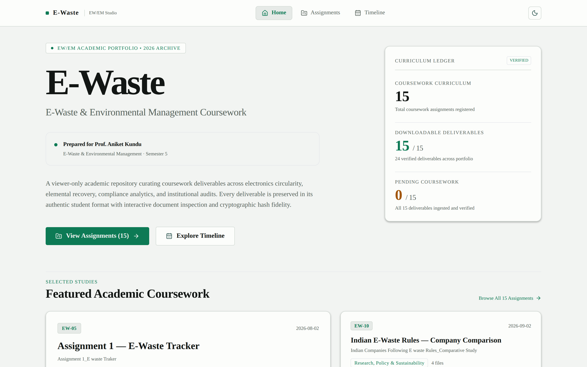
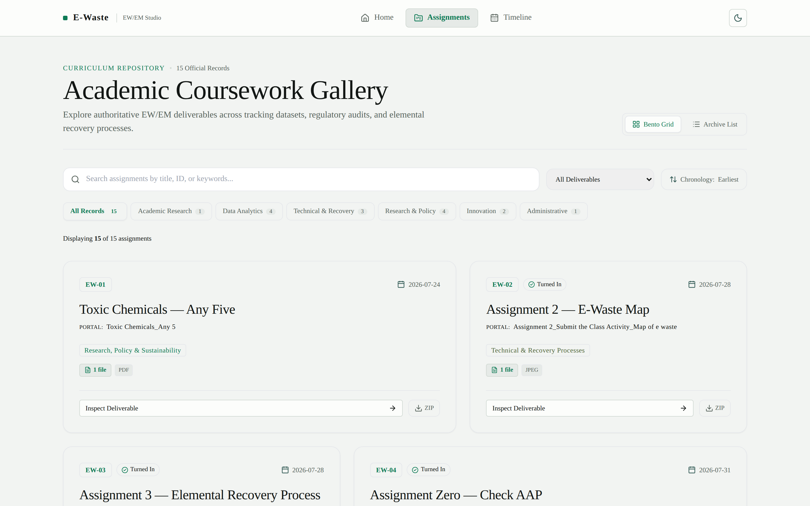
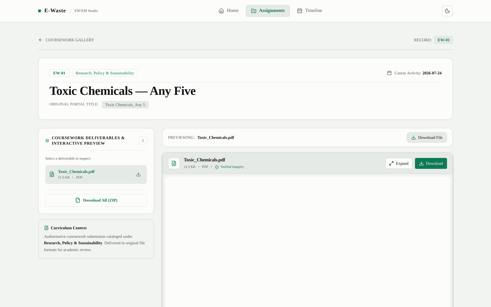
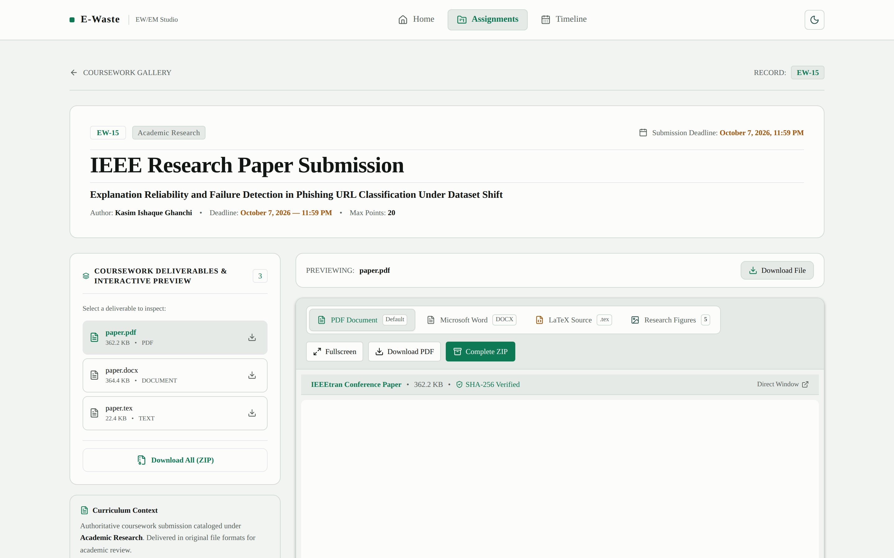
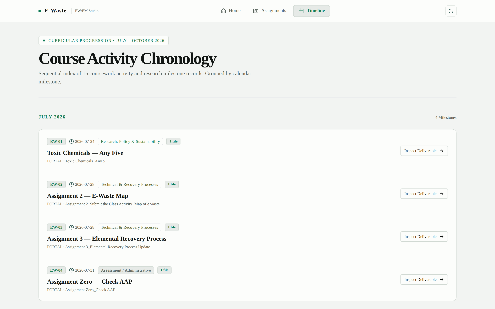
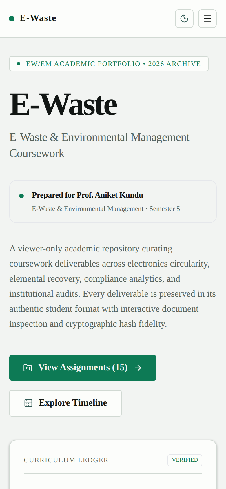

# E-Waste

**An Interactive Academic Portfolio for E-Waste & Environmental Management**

A viewer-only academic web platform uniting coursework deliverables, environmental research, interactive document previews, authentic student downloads, and course activity chronology into one cohesive, accessible interface.

> **Academic Dedication**  
> **Prepared for Prof. Aniket Kundu**  
> *Course:* E-Waste & Environmental Management &middot; Semester 5  
> *Author:* Kasim Ishaque Ghanchi

---

[](https://nextjs.org/)
[](https://react.dev/)
[](https://www.typescriptlang.org/)
[](https://tailwindcss.com/)
[](https://playwright.dev/)
[](https://vitest.dev/)

**Quick Links:** [Assignment Gallery](#assignment-collection) &middot; [Research Paper](#research-paper-feature) &middot; [Course Timeline](#course-timeline) &middot; [Local Installation](#local-installation-and-usage) &middot; [Vercel Deployment](#deployment)

---



---

## Project Overview

**E-Waste — Environmental Management Academic Portfolio** is a specialized, read-only academic web application engineered to catalog, preserve, and review coursework for the *Electronic Waste & Environmental Management* curriculum.

Unlike administrative learning management systems or static slides, this studio delivers:
- **Direct Document Inspection:** Read submitted PDFs, slide decks, Word documents, Excel workbooks, and interactive HTML class projects directly inside the browser.
- **Cryptographic File Fidelity:** Every deliverable is cataloged with verified SHA-256 integrity hashes, byte-accurate file sizes, and genuine MIME types.
- **Academic Research Integration:** Complete manuscript viewer for an IEEE research paper deliverable, including LaTeX source code, multi-format manuscripts, and high-resolution supporting figures.
- **Archival Download Pipeline:** Download individual authentic coursework files or one-click complete ZIP archives per assignment.
- **Chronological Ledger:** Clear course activity timeline tracing semester milestones from July to October 2026 without conflating activity dates with verified due dates.

---

## Key Features

- **15 Authoritative Coursework Records:** Contiguous assignments spanning `EW-01` through `EW-15` covering data analytics, circularity, recovery engineering, policy audits, and original research.
- **Assignment Gallery with Real-Time Filtering:** Instant keyword search across titles and portal identifiers, category pills, and file-availability status filtering.
- **Universal Document Inspection Engine:**
  - **PDF Documents:** Embedded canvas viewer with page navigation, zoom, and fullscreen inspection.
  - **PowerPoint Decks (`.pptx`):** Slide carousel viewer with slide counter and step-by-step progress indicator.
  - **Excel Spreadsheets (`.xlsx`):** In-browser workbook parser displaying real sheets, columns, and tabular rows.
  - **Word Manuscripts (`.docx`):** Clean rendered previews with document structure preserved.
  - **Classroom HTML Activities:** Sandboxed preview frames (`sandbox="allow-scripts"`) for campus campaign tools and carbon calculators.
  - **Image Submissions (`.jpeg`, `.png`):** High-resolution image canvas with zoom and pan controls.
- **One-Click Deliverable Downloads:** Streaming ZIP packaging for assignments via serverless API routes.
- **IEEE Research Paper Viewer:** Multi-tab reader for `paper.pdf`, `paper.docx`, `paper.tex`, and 5 high-resolution research figures with download options.
- **Course Activity Timeline:** Architectural chronology mapping every portal milestone and submission deadline.
- **Responsive & Accessible Design:** Handcrafted Swiss typography, minimal dark/light theme support, accessible Radix primitives, and full mobile optimization.

---

## Visual Preview Gallery

| Academic Coursework Gallery | Interactive Assignment Detail Viewer |
| :---: | :---: |
|  |  |
| *Browse and filter 15 curriculum deliverables by category and format* | *Inspect genuine PDFs and download authentic student coursework* |

| IEEE Research Paper Viewer | Course Activity Chronology |
| :---: | :---: |
|  |  |
| *Multi-tab reader for PDF, Word, LaTeX source, and research figures* | *Milestone sequence tracking curriculum progression* |

<div align="center">
  
  <p><em>Optimized mobile layout for responsive inspection across all screen sizes</em></p>
</div>

---

## Assignment Collection

The portfolio indexes exactly **15 coursework deliverables** based on student submissions and academic records.

| ID | Deliverable Title | Category | Portal Activity Date | Available Formats |
| :---: | :--- | :--- | :---: | :---: |
| **EW-01** | Toxic Chemicals — Any Five | Research, Policy & Sustainability | 2026-07-24 | PDF |
| **EW-02** | Assignment 2 — E-Waste Map | Technical & Recovery Processes | 2026-07-28 | JPEG |
| **EW-03** | Assignment 3 — Elemental Recovery Process | Technical & Recovery Processes | 2026-07-28 | JPEG |
| **EW-04** | Assignment Zero — Check AAP | Assessment / Administrative | 2026-07-31 | PDF |
| **EW-05** | Assignment 1 — E-Waste Tracker | Data Analytics & Tracking | 2026-08-02 | XLSX, PDF (2) |
| **EW-06** | E-Waste: India vs World | Data Analytics & Tracking | 2026-08-04 | PDF |
| **EW-07** | Carbon Footprint — Excel Activity | Data Analytics & Tracking | 2026-08-11 | JPEG |
| **EW-08** | State Tracker — Presentation | Data Analytics & Tracking | 2026-08-12 | PPTX |
| **EW-09** | E-Waste Recovery — Design Patent Modification | Technical & Recovery Processes | 2026-08-19 | PDF |
| **EW-10** | Indian E-Waste Rules — Company Comparison | Research, Policy & Sustainability | 2026-09-02 | PDF, DOCX, HTML (2) |
| **EW-11** | Novel E-Waste Idea — Pitch Deck | Innovation & Awareness | 2026-09-06 | PPTX, PDF |
| **EW-12** | Campus E-Waste Awareness Campaign | Innovation & Awareness | 2026-09-09 | HTML (2) |
| **EW-13** | LEED-Certified Buildings in India | Research, Policy & Sustainability | 2026-09-29 | HTML |
| **EW-14** | E-Waste Case Studies | Research, Policy & Sustainability | 2026-10-04 | PPTX |
| **EW-15** | IEEE Research Paper Submission | Academic Research | 2026-10-07 | PDF, DOCX, TeX, Figures, ZIP |

> **Integrity Note:** Portal activity dates record observed timestamp sequence in the coursework repository, not verified due dates. Portal submission badges (`Turned in`) represent observed status, preserved independently from instructor evaluation or grading.

---

## Research Paper Feature

Assignment **EW-15** presents an academic research deliverable integrated directly into the portfolio:

**"Explanation Reliability and Failure Detection in Phishing URL Classification Under Dataset Shift"**  
*Author:* Kasim Ishaque Ghanchi &middot; *Max Points:* 20 &middot; *Deadline:* October 7, 2026

### Available Formats & Deliverables

1. **PDF Manuscript:** Full IEEE-formatted double-column conference paper available for in-browser reading and direct download.
2. **Microsoft Word (`.docx`):** Rendered preview with complete layout integrity and download option.
3. **LaTeX Source (`.tex`):** Full LaTeX document source with IEEEtran document class, syntax-highlighted and downloadable.
4. **Research Figures Gallery:** High-resolution supporting figures including:
   - `research_workflow.png` / `.pdf` — End-to-end experimental architecture
   - `published_dataset_balance.png` / `.pdf` — Distribution analysis under dataset shift
   - `ai_workflow_concept.png` — Conceptual attribution pipeline
   - `ablation_schema.png` / `.pdf` — Multi-stage ablation schema
   - `evaluation_dimensions.png` / `.pdf` — Multi-metric reliability dimensions
5. **Complete Source Archive:** Single-click download of `Research_Paper.zip` containing all manuscript formats and figures.

---

## Technology Stack

| Layer | Technologies | Rationale |
| :--- | :--- | :--- |
| **Core Framework** | [Next.js 15.5](https://nextjs.org/) (App Router) | High-performance React framework with server components and streaming routes |
| **Language** | [TypeScript 5.x](https://www.typescriptlang.org/) | Strict type safety across domain contracts, file manifests, and storage adapters |
| **Styling & Design** | [Tailwind CSS 3.4](https://tailwindcss.com/) | Bespoke Swiss-inspired editorial design system with strict 4px spacing and accessible contrast |
| **Icons & UI Primitives** | [Lucide React](https://lucide.dev/), Tailwind Primitives | Crisp, semantic icons and keyboard-navigable components |
| **Spreadsheet Engine** | [SheetJS (xlsx)](https://docs.sheetjs.com/) | Real client-side parsing and rendering of multi-sheet Excel workbooks |
| **Archive Generation** | [JSZip 3.10](https://stuk.github.io/jszip/) | Dynamic streaming ZIP packaging for assignment file bundles |
| **End-to-End Testing** | [Playwright 1.64](https://playwright.dev/) | Cross-browser automated verification for all routes, viewers, and downloads |
| **Unit Testing** | [Vitest 5.0](https://vitest.dev/) | High-speed unit tests verifying seed integrity and schema invariants |
| **Deployment Platform** | [Vercel](https://vercel.com/) | Serverless deployment with edge caching headers and static asset delivery |

---

## Project Structure

```
RECLAIM/
├── data/
│   └── assignments.seed.json        # Authoritative 15-assignment curriculum seed
├── docs/
│   └── images/                      # Authentic high-resolution project screenshots
│       ├── homepage.png
│       ├── assignments.png
│       ├── assignment-viewer.png
│       ├── research-paper.png
│       ├── timeline.png
│       └── mobile.png
├── public/
│   ├── coursework/                  # Packaged coursework files and preview assets
│   │   ├── files/                   # Downloadable student deliverables
│   │   └── previews/                # Generated slide PNGs and PDF previews
│   ├── research-paper/              # Research paper source files and complete ZIP
│   ├── favicon.ico                  # Classic desktop favicon
│   ├── icon.png                     # Modern browser PNG icon
│   └── apple-icon.png               # Apple touch icon (180×180)
├── src/
│   ├── app/
│   │   ├── api/                     # Serverless API routes (file streams, ZIPs, previews)
│   │   ├── assignments/             # Gallery and dynamic [id] workbench routes
│   │   ├── timeline/                # Course activity chronology route
│   │   ├── layout.tsx               # Root layout, metadata, and Open Graph definitions
│   │   └── page.tsx                 # Academic homepage with hero and ledger metrics
│   ├── components/
│   │   ├── shell/AppShell.tsx       # 3-tab responsive navigation header and footer
│   │   ├── ui/primitives.tsx        # Buttons, cards, and status badge primitives
│   │   └── viewer/                  # Universal document & research paper viewers
│   ├── data/
│   │   ├── courseworkManifest.json  # Cryptographic manifest of all 24 deliverables
│   │   └── researchPaperManifest.json # Metadata manifest for IEEE research deliverables
│   ├── lib/storage/                 # Local persistence and seed loading adapters
│   ├── styles/globals.css           # Design tokens, color system, and typography
│   └── types/domain.ts              # Authoritative domain TypeScript interfaces
├── tests/
│   ├── e2e.spec.js                  # Playwright E2E browser verification suite
│   └── seedIntegrity.test.ts        # Vitest seed schema and distribution checks
├── package.json                     # Project scripts and dependencies
├── tailwind.config.js               # Tailwind design system configuration
└── vercel.json                      # Vercel deployment and security header configuration
```

---

## Local Installation and Usage

### Prerequisites
- Node.js 20.x or 22.x LTS
- npm 10.x or higher

### 1. Clone the Repository
```bash
git clone https://github.com/your-username/ewaste-portfolio.git
cd ewaste-portfolio
```

### 2. Install Dependencies
```bash
npm install
```

### 3. Start Development Server
```bash
npm run dev
```
Open [http://localhost:3000](http://localhost:3000) in your browser.

### 4. Run TypeScript Check
```bash
npm run typecheck
```

### 5. Run Unit Tests
```bash
npm test
```

### 6. Run Browser End-to-End Tests
Ensure the production server or local dev server is running on port 3000, then execute:
```bash
npm run test:e2e
```

### 7. Build for Production
```bash
npm run build
npm start
```

---

## Deployment

The application is architected for zero-configuration deployment on **Vercel**.

### Vercel Deployment Instructions

1. **Push to GitHub / GitLab:**
   Ensure your latest commits (including `public/coursework/` and `src/data/courseworkManifest.json`) are committed to your repository.

2. **Import Project on Vercel:**
   - Log in to the [Vercel Dashboard](https://vercel.com/new).
   - Select your Git repository.
   - Framework Preset: **Next.js**.
   - Root Directory: `./` (leave default).
   - Build Command: `npm run build`.
   - Output Directory: `.next`.

3. **Deploy:**
   Click **Deploy**. Vercel will build and deploy the application in under 60 seconds.

### Serverless Deliverable Architecture
All 24 authentic coursework files and generated slide assets are stored inside `public/coursework/` and `public/research-paper/`. API routes (`/api/coursework/file/[fileId]`, `/api/download/[id]`, `/api/research-paper/zip`) inspect both storage locations with fallback logic, guaranteeing 100% download and preview reliability in serverless environments without requiring persistent local filesystem access.

---

## Academic Dedication and Credits

**Academic Supervision:**  
Prepared for **Prof. Aniket Kundu**  
Department of Computer Engineering  
*Course:* Electronic Waste & Environmental Management (EW/EM)  
*Term:* Semester 5, Academic Year 2026–2027

**Student Author:**  
**Kasim Ishaque Ghanchi**  
Student Researcher & Lead Author

**Intellectual Property & Academic Integrity:**  
All coursework submissions, spreadsheets, presentations, and research papers contained in this portfolio are original student works prepared for the EW/EM curriculum. External regulatory frameworks (CPCB E-Waste Management Rules 2016/2022, LEED Green Building Rating System) are referenced for educational and academic analysis.

---

## License

This academic portfolio software is open-source under the [MIT License](LICENSE). Coursework deliverables and research manuscripts belong to the respective author and may not be plagiarized or republished without explicit academic citation.

---

<div align="center">
  <sub><strong>E-Waste Academic Portfolio</strong> &middot; Department of Computer Engineering &middot; 2026</sub>
</div>
